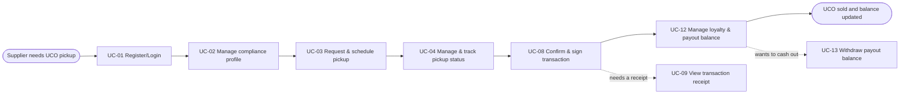

# Usage Flow: ReFeed System

> Usage flows for ReFeed System across key actors.

| Field | Value |
|---|---|
| Product | ReFeed System |
| Version | v1.2 |
| Sources | W0 Table 1 (use case inventory); Use Case Diagram v2.1; `docs/activity/activity-index.md`; `screen-list.md` |

## Before you draw: is Lesson 4 still true?

- [x] Every row of the Inputs check table in `docs/activity/activity-index.md` is "Done" or logged
      as an open question.

## UCO Supplier: Schedule pickup, track status & manage payout

| Step | Use case | Activity diagram | Screens |
|---|---|---|---|
| 1 | UC-01 Register/Login as a UCO supplier | `AD-UC-01.md` | S-F00-01, S-F01-01 |
| 2 | UC-02 Manage Point-of-Origin and compliance profile | not needed | S-F01-02 |
| 3 | UC-03 Request and schedule a UCO pickup | `AD-UC-03.md` | S-F01-03 |
| 4 | UC-04 Manage and track an existing pickup status | `AD-UC-04.md` | S-F01-04, S-F01-05 (modal "Cancel this pickup request?"), S-F01-03 (edit mode, reschedule) |
| 5 | UC-08 Confirm and sign a UCO transaction | not needed | S-F03-01 (modal "Confirm and e-sign") |
| 6 | UC-12 Manage loyalty status and accumulated payout balance | `AD-UC-12.md` | S-F05-01 |
| (alt) | UC-13 Withdraw accumulated payout balance | `AD-UC-13.md` | S-F05-02 (modal "Confirm withdrawal") |
| (alt) | UC-09 View or download transaction receipt | not needed | S-F03-02 |

## UCO Collector: Execute collection route & handover

| Step | Use case | Activity diagram | Screens |
|---|---|---|---|
| 1 | UC-06 Check scheduled collection route | `AD-UC-06.md` | S-F02-03, S-F02-04 (modal "UCO not ready: cancel this pickup?") |
| 2 | UC-07 Input handover information | `AD-UC-07.md` | S-F02-05 |

## Warehouse Staff: Verify inbound UCO & manage batch traceability

| Step | Use case | Activity diagram | Screens |
|---|---|---|---|
| 1 | UC-10 Receive and verify collected UCO at warehouse | `AD-UC-10.md` | S-F04-01 |
| 2 | UC-11 Manage UCO batch and mass-balance records | `AD-UC-11.md` | S-F04-02 |

## ReFeed Staff: Route planning & fleet dispatch

| Step | Use case | Activity diagram | Screens |
|---|---|---|---|
| 1 | UC-05 Plan and dispatch a UCO collection route | `AD-UC-05.md` | S-F02-01, S-F02-02 (modal "Confirm route and dispatch?") |

Each actor of ReFeed System comes for one goal, so each has one flow.

## Use cases without a flow

| Use case | Started by | Described in |
|---|---|---|
| UC-14 View Green Profile & UCO contribution history | Supplier (read-only query) | S-F05-03; no activity diagram needed |
| UC-15 Access ESG / environmental contribution reports | Supplier (read-only query) | S-F05-04; no activity diagram needed |
| UC-16 Monitor operations & trace UCO | ReFeed Staff (read-only query) | S-F06-01; no activity diagram needed |
| UC-17 Review audit trail & compliance reports | ReFeed Staff (read-only query) | S-F06-02; no activity diagram needed |

## Checks before you save

- [x] Every actor that starts a use case has at least one flow.
- [x] An actor with clearly different goals has one flow per goal; no flow has more than about
      9 boxes (Supplier 8 use cases, Collector 2, Warehouse Staff 2, ReFeed Staff 1).
- [x] Every actor name matches the Use Case Diagram and the Context Diagram.
- [x] Coverage: UC-01 to UC-13 each appear in a flow with the same ID and name; UC-14 to UC-17
      are listed under "Use cases without a flow".
- [x] No box is a click or a screen; no box tells two use cases.
- [x] Every flow renders on mermaid.live.
- [x] Every step has at least one screen, and every screen in `screen-list.md` appears in some
      step or in "Use cases without a flow".
