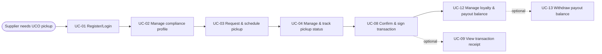
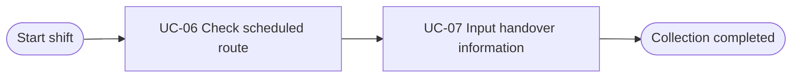
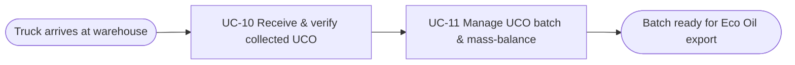
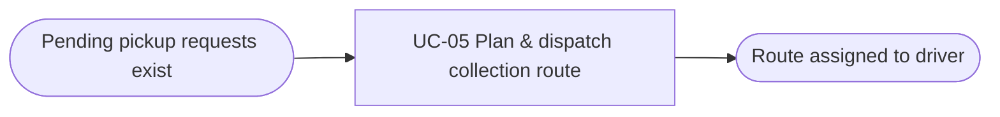

# Usage Flow: ReFeed System

> Usage flows for ReFeed System across key actors.

| Field | Value |
|---|---|
| Product | ReFeed System |
| Version | v1.0 |
| Sources | W0 Table 1 (use case inventory); Use Case Diagram v2.1; `docs/activity/activity-index.md` |

## Before you draw: is Lesson 4 still true?

- [x] Every row of the Inputs check table in `docs/activity/activity-index.md` is "Done" or logged as an open question.

## UCO Supplier: Schedule pickup, track status & manage payout

| Step | Use case | Activity diagram | Screens |
|---|---|---|---|
| 1 | UC-01 Register/Login as a UCO supplier | not needed | SCR-SUP-01 |
| 2 | UC-02 Manage Point-of-Origin and compliance profile | not needed | SCR-SUP-02 |
| 3 | UC-03 Request and schedule a UCO pickup | not needed | SCR-SUP-03 |
| 4 | UC-04 Manage and track an existing pickup status | `AD-UC-04.md` | SCR-SUP-04, SCR-SUP-05, SCR-SUP-06 |
| 5 | UC-08 Confirm and sign a UCO transaction | not needed | SCR-SUP-07 |
| 6 | UC-12 Manage loyalty status and accumulated payout balance | not needed | SCR-SUP-08 |
| (alt) | UC-13 Withdraw accumulated payout balance | not needed | SCR-SUP-09 |
| (alt) | UC-09 View or download transaction receipt | not needed | SCR-SUP-10 |

## UCO Collector: Execute collection route & handover

| Step | Use case | Activity diagram | Screens |
|---|---|---|---|
| 1 | UC-06 Check scheduled collection route | not needed | SCR-DRV-01 |
| 2 | UC-07 Input handover information | not needed | SCR-DRV-02 |

## Warehouse Staff: Verify inbound UCO & manage batch traceability

| Step | Use case | Activity diagram | Screens |
|---|---|---|---|
| 1 | UC-10 Receive and verify collected UCO at warehouse | `AD-UC-10.md` | SCR-WHS-01 |
| 2 | UC-11 Manage UCO batch and mass-balance records | `AD-UC-11.md` | SCR-WHS-02, SCR-WHS-03 |

## ReFeed Admin: Route planning & fleet dispatch

| Step | Use case | Activity diagram | Screens |
|---|---|---|---|
| 1 | UC-05 Plan and dispatch a UCO collection route | not needed | SCR-ADM-01 |

## Use cases without a flow

| Use case | Started by | Described in |
|---|---|---|
| UC-14 View Green Profile & UCO contribution history | Supplier Query / Read-only | Query export screen |
| UC-15 Access ESG / environmental contribution reports | Supplier Query / Read-only | PDF Report generator |
| UC-16 Monitor operations & trace UCO | Admin / Compliance Query | Admin Dashboard |
| UC-17 Review audit trail & compliance reports | Admin / Audit Query | Compliance Log View |

## Checks before you save

- [x] Every actor that starts a use case has at least one flow.
- [x] An actor with clearly different goals has one flow per goal; no flow has more than about 9 boxes.
- [x] Every actor name matches the Use Case Diagram and the Context Diagram.
- [x] Coverage: All Must/Should use cases appear in a flow or in "Use cases without a flow".
- [x] No box is a click or a screen; no box tells two use cases.
- [x] Every flow renders on mermaid.live.
- [x] Every step has at least one screen.