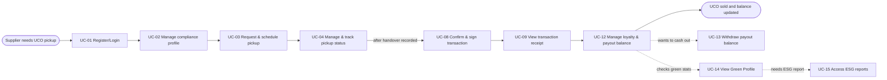
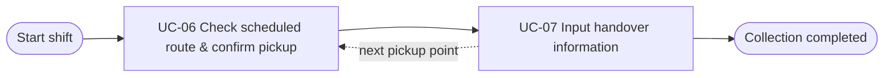
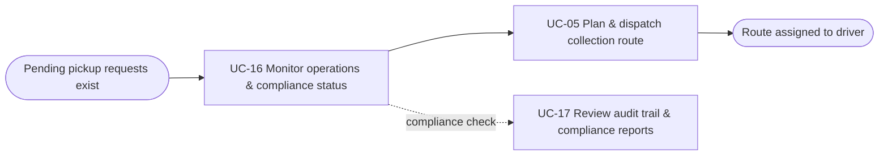

# Usage Flow: ReFeed System

> Usage flows for ReFeed System across key actors.

| Field | Value |
|---|---|
| Product | ReFeed System |
| Version | v1.3 |
| Sources | W0 Table 1 (use case inventory); W4 Prioritization; Use Case Diagram v2.1; `docs/activity/activity-index.md`; `screen-list.md`; `screen-transition.md` |

## Before you draw: is Lesson 4 still true?

- [x] Every row of the Inputs check table in `docs/activity/activity-index.md` is "Done" or logged
      as an open question. Role labels (`Operations Staff`, `Refeed Admin`) are consolidated under
      `Refeed Staff` to match the Use Case Diagram and `screen-transition.md`, and `FR-04-03`
      (end-to-end supply-chain tracing) is deferred to Release 2 per `W4_Prioritization`.

## Supplier: Schedule pickup, track status & manage payout

| Step | Use case | Activity diagram | Screens |
|---|---|---|---|
| 1 | UC-01 Register/Login as a UCO supplier | not needed | S-F00-01, S-F01-01, S-F00-02 |
| 2 | UC-02 Manage Point-of-Origin and compliance profile | `AD-UC-02.md` | S-F01-01, S-F01-06, S-F01-02 |
| 3 | UC-03 Request and schedule a UCO pickup | `AD-UC-03.md` | S-F01-03 |
| 4 | UC-04 Manage and track an existing pickup status | `AD-UC-04.md` | S-F01-04, S-F01-05 (modal "Cancel this pickup request?"), S-F01-03 (edit mode, reschedule) |
| 5 | UC-08 Confirm and sign a UCO transaction | [AD-UC-08](../activity/AD-UC-08.md) | S-F03-01 (modal "Confirm and e-sign"); interactions in [SD-UC-08](../use-case/SD-UC-08.md) |
| 6 | UC-09 View or download transaction receipt | not needed | S-F03-02 |
| 7 | UC-12 Manage loyalty status and accumulated payout balance | `AD-UC-12.md` | S-F05-01 |
| (alt) | UC-13 Withdraw accumulated payout balance | `AD-UC-13.md` | S-F05-02 (modal "Confirm withdrawal") |
| (alt) | UC-14 View Green Profile & UCO contribution history | not needed | S-F05-03 |
| (alt) | UC-15 Access ESG / environmental contribution reports | not needed | S-F05-04 |

## Driver / Collector: Execute collection route & handover

| Step | Use case | Activity diagram | Screens |
|---|---|---|---|
| 1 | UC-06 Check scheduled collection route and confirm delivery to supplier points | `AD-UC-06.md` | S-F02-03, S-F02-04 (modal "UCO not ready: cancel this pickup?") |
| 2 | UC-07 Input handover information | `AD-UC-07.md` | S-F02-05 |

## Warehouse Staff: Verify inbound UCO & manage batch traceability

| Step | Use case | Activity diagram | Screens |
|---|---|---|---|
| 1 | UC-10 Receive and verify collected UCO at warehouse | `AD-UC-10.md` | S-F00-03, S-F04-01 |
| 2 | UC-11 Manage UCO batch and mass-balance records | `AD-UC-11.md` | S-F04-02 |

## Refeed Staff: Monitor operations, dispatch routes & review audit trail

| Step | Use case | Activity diagram | Screens |
|---|---|---|---|
| 1 | UC-16 Monitor operations and compliance status | not needed | S-F06-01 |
| 2 | UC-05 Plan and dispatch a UCO collection route | `AD-UC-05.md` | S-F02-01, S-F02-02 (modal "Confirm route and dispatch?") |
| (alt) | UC-17 Review audit trail and generate compliance reports | not needed | S-F06-02 |

Each actor of ReFeed System comes for one goal, so each has one flow.

## Use cases without a flow

No Release-1 use case is excluded: `UC-01` to `UC-17` all appear in an actor flow above. Out-of-scope / Release-2 items (`FR-04-03` supply-chain tracing, in-app direct payout transfer, and real-time driver–supplier chat) are intentionally omitted.

## Checks before you save

- [x] Every actor that starts a use case has at least one flow.
- [x] An actor with clearly different goals has one flow per goal; no flow has more than about
      9 boxes (Supplier 10 use cases across one end-to-end lifecycle, Driver / Collector 2,
      Warehouse Staff 2, Refeed Staff 3).
- [x] Every actor name (`Supplier`, `Driver / Collector`, `Warehouse Staff`, `Refeed Staff`)
      matches the Use Case Diagram, `screen-transition.md`, and the Context Diagram.
- [x] Coverage: UC-01 to UC-17 each appear in a flow with the same ID and name; no Won't-have
      or Release-2 use case appears.
- [x] No box is a click or a screen; no box tells two use cases.
- [x] Every flow renders on mermaid.live.
- [x] Every step has at least one screen, and every screen in `screen-list.md` appears in some
      step (24 of 24 screens and 5 of 5 modals covered).
