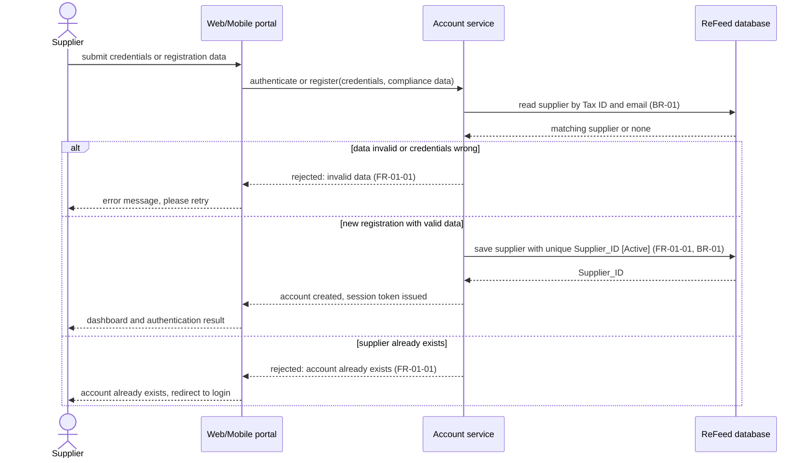

# Sequence Diagram: SD-UC-01 Register / Login as a UCO supplier

Lesson 4, analysis level: how the parts of ReFeed talk to each other when a supplier submits
registration data or credentials. The lifelines are the elements of the
[physical design](../architecture/architecture.md). The supplier's choice (to submit credentials or
registration data) is shown in the activity diagram [AD-UC-01](../activity/AD-UC-01.md), not here.

| Field | Value |
|---|---|
| Use case | UC-01 Register / Login as a UCO supplier |
| Version | v1 (from AD-UC-01 v1.0) |
| FRs | FR-01-01 |

The `alt` fragments here are outcomes decided inside the system, so they belong in a sequence
diagram. The supplier's choice between registering and logging in would be a decision in the
activity diagram instead.
