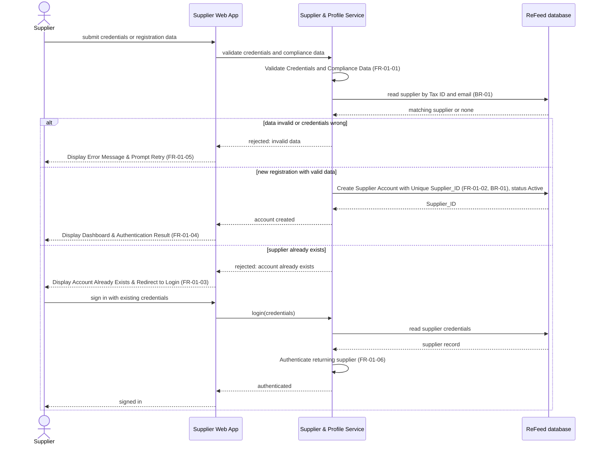

# Sequence Diagram: SD-UC-01 Register / Login as a UCO supplier

Lesson 4, analysis level: how the parts of ReFeed talk to each other when a supplier submits
registration data or credentials. The lifelines are the elements of the
[physical design](../architecture/architecture.md). The supplier's actions (submit data, sign in again) are
shown in the activity diagram [AD-UC-01](../activity/AD-UC-01.md). This sequence shows the system's
internal messages and results.

| Field | Value |
|---|---|
| Use case | UC-01 Register / Login as a UCO supplier |
| Primary actor | Supplier |
| Version / status | v2.0 · Rebuilt on the current W1 |
| Inputs | [AD-UC-01](../activity/AD-UC-01.md) · [W1](../function-list/w1-function-list.md) FR-01-01 to FR-01-06 |
| FRs | FR-01-01, FR-01-02, FR-01-03, FR-01-04, FR-01-05, FR-01-06 (each appears once) |
| Preconditions | The supplier has access to the ReFeed Web/Mobile Portal. |
| Success end state | A new supplier has an `Active` account and sees the dashboard, or a returning supplier is authenticated. |
| Other results | Invalid data: no account or session is created and the supplier is prompted to retry. |

The `alt` fragments are outcomes decided inside the system, so they belong in a sequence diagram. The
supplier's own actions are the same ones as in the activity diagram. Each FR is written on one message
only, with its exact W1 name, in the same place as the matching action in AD-UC-01.
