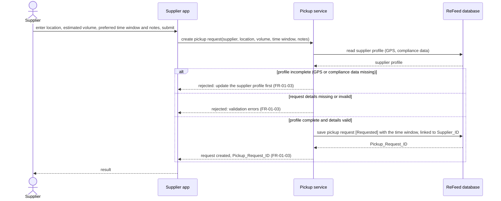

# Sequence Diagram: SD-UC-03 Request and schedule a UCO pickup

Lesson 4, analysis level: how the parts of the ReFeed System talk to each other when a supplier
requests a UCO pickup. The lifelines are the elements of the [physical design](../architecture/architecture.md).
The supplier's own steps (entering the request details, correcting them, updating the profile)
are shown in the activity diagram [AD-UC-03](../activity/AD-UC-03.md), not here.

| Field | Value |
|---|---|
| Use case | UC-03 Request and schedule a UCO pickup |
| Version | v1 |
| FRs | FR-01-03 |

The `alt` fragments here are outcomes decided inside the system (profile check, validation), so
they belong in a sequence diagram. The supplier correcting the details and resubmitting is a loop
in the activity diagram AD-UC-03 instead.
