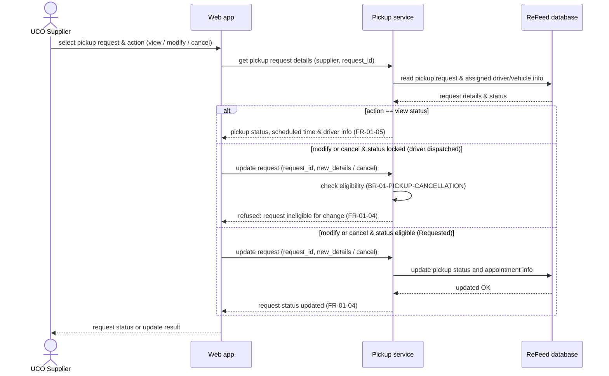

# Sequence Diagram: SD-UC-04 Manage and track an existing pickup status

> Analysis level sequence diagram for ReFeed System. The UCO Supplier views real-time pickup status, scheduled collection details, or submits a request modification/cancellation.

| Field | Value |
|---|---|
| Use case | UC-04 Manage and track an existing pickup status |
| Version | v1 |
| FRs | FR-01-04, FR-01-05 |

