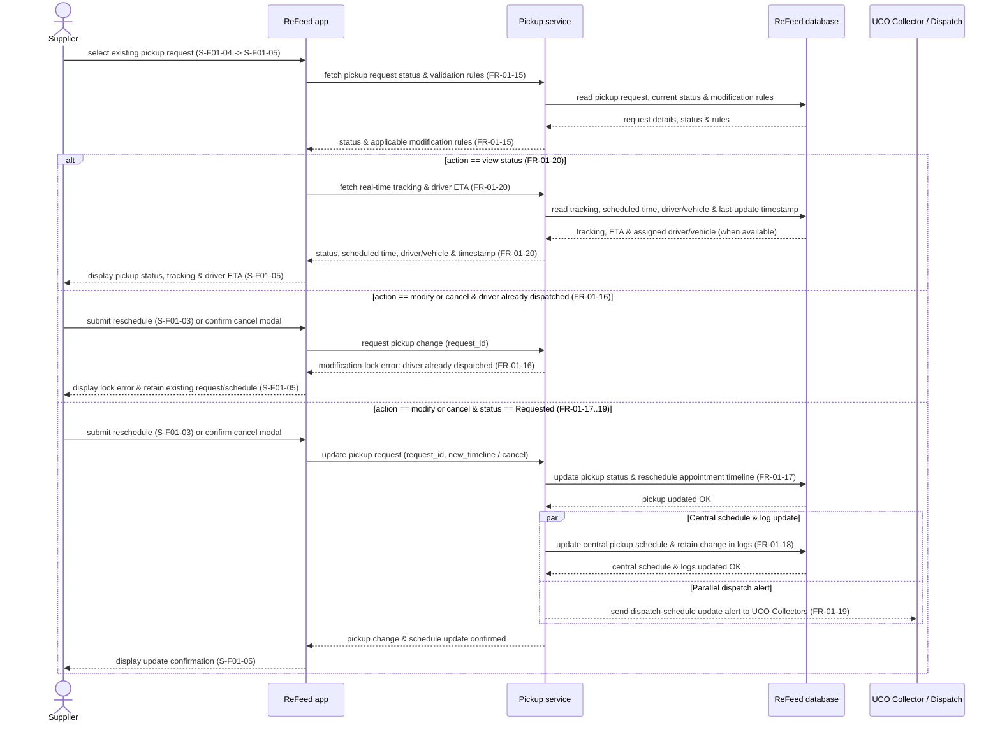

# Sequence Diagram: SD-UC-04 Manage and track an existing pickup status

> Analysis-level sequence diagram for ReFeed System (aligned with W0/W1 revision `08e751f` and Screen List). The UCO Supplier views real-time pickup status, tracking, and driver ETA, or submits an eligible request modification/cancellation.

| Field | Value |
|---|---|
| Use case | UC-04 Manage and track an existing pickup status |
| Feature | F-01 Supplier Onboarding & Pickup Management |
| Primary actor | Supplier (`UCO Supplier`) |
| Version | v2 (aligned with `08e751f`) |
| FRs | FR-01-15, FR-01-16, FR-01-17, FR-01-18, FR-01-19, FR-01-20 |
| Effective priority (W4) | Should (`FR-01-15`–`FR-01-19`); Could (`FR-01-20`) |
| Activity diagram map | AD-UC-04 (`s1` → `FR-01-15`, `s2` → `FR-01-20`, `s3` → `FR-01-16`, `s4` → `FR-01-17`, `s5` → `FR-01-18`, `c1` → `FR-01-19`) |
| Related screens | `S-F01-04` (My pickup requests), `S-F01-05` (Pickup request detail), `S-F01-03` (Pickup request form — Reschedule mode), Modal: *Cancel this pickup request?* |

