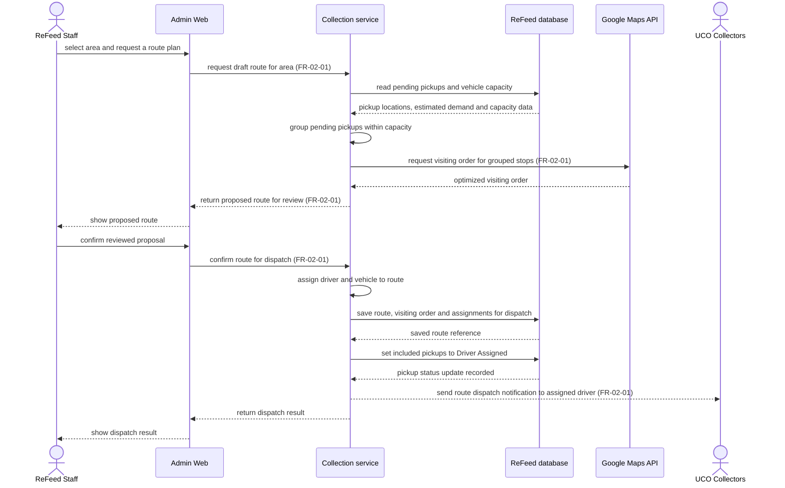

# Sequence Diagram: SD-UC-05 Plan and dispatch a UCO collection route

Lesson 4, analysis level. This sequence shows how ReFeed's parts plan and dispatch one confirmed route. The staff decision and the unconfirmed path are in [AD-UC-05](../activity/AD-UC-05.md).

| Field | Value |
|---|---|
| Use case | UC-05 Plan and dispatch a UCO collection route |
| Version | v1 · Draft for group review |
| Primary actor | ReFeed Staff |
| FRs | `FR-02-01` |
| Verification | Rendered on Mermaid Live v12.2.0 (2026-11-07). |
| Inputs | [CVCA](../context/cvca.md) StR-02 · [Context Diagram](../context/context-diagram.md) · [W1](../function-list/w1-function-list.md) `FR-02-01-FE`, `FR-02-01-BE`, `FR-02-01-INT` · [Screen List](../external-design/screen-list.md) `S-F02-01`, `S-F02-02` |

- The presentation, service and data lifelines follow W1 work-item responsibilities and the naming in [SD-UC-06](SD-UC-06.md). Their final allocation is pending the ReFeed [architecture](../architecture/architecture.md). Message labels describe analysis interactions. API contracts, transaction boundaries and delivery guarantees remain open.
- Google Maps API supplies an optimized stop order for a group that already fits the vehicle-capacity constraint. The integration is in W1. Its absence from the four-actor Context Diagram is logged in the [Activity Diagram Index](../activity/activity-index.md).
- Confirming the draft gates assignment, persistence and dispatch. The driver's next use case starts on opening the assigned route. The notification channel and handling for an unavailable route service, stale capacity, concurrent assignment or a failed notification are open in AD-UC-05.
- W1 cites the legacy sequence reference `SEQ:S-01`. This file is the UC-specific sequence for `FR-02-01`.
