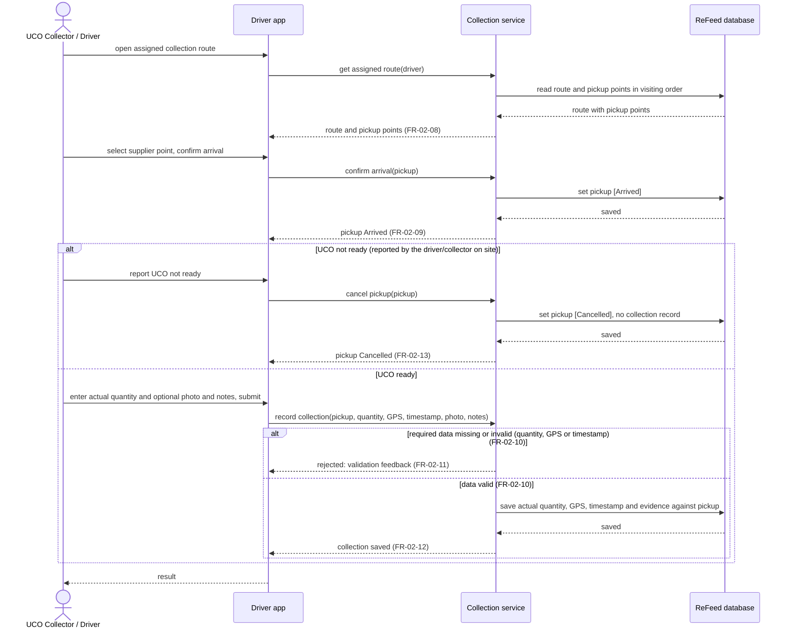

# Sequence Diagram: SD-UC-06 Check scheduled collection route and Confirm Delivery to supplier points

Lesson 4, analysis level: how the parts of the ReFeed System talk to each other when a driver/collector
works through an assigned collection route at one supplier point. The lifelines are the elements of the
[physical design](../architecture/architecture.md). The driver/collector's choices (which supplier point
next, whether UCO is ready, correcting the details) are shown in the activity diagram
[AD-UC-06](../activity/AD-UC-06.md), not here.

| Field | Value |
|---|---|
| Use case | UC-06 Check scheduled collection route and Confirm Delivery to supplier points |
| Version | v1 |
| FRs | FR-02-08, FR-02-09, FR-02-10, FR-02-11, FR-02-12, FR-02-13 |

The outer `alt` follows what the driver/collector reports on site: whether UCO is ready is the
driver/collector's judgement, so the choice itself is the decision `d0` in AD-UC-06, but cancelling the
pickup is done by the system (`FR-02-13`), so the messages that carry it out are shown here. The inner
`alt` is an outcome decided inside the system (validation of the collection data). Correcting the details
and resubmitting, and moving on to the next supplier point, are the loops through `m1` and `d2` in the
same activity diagram.
