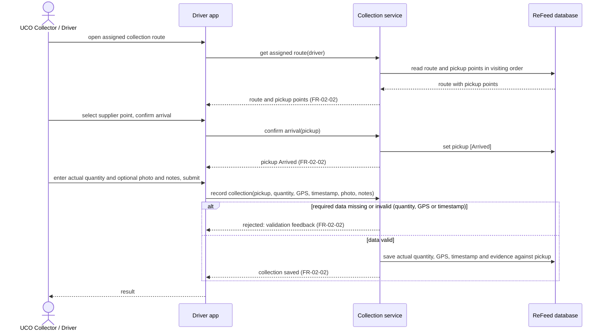

# Sequence Diagram: SD-UC-06 Check scheduled collection route and Confirm Delivery to supplier points

Lesson 4, analysis level: how the parts of the ReFeed System talk to each other when a driver/collector
works through an assigned collection route at one supplier point. The lifelines are the elements of the
[physical design](../architecture/architecture.md). The driver/collector's choices (which supplier point
next, whether UCO is ready, correcting the details) are shown in the activity diagram
[AD-UC-06](../activity/AD-UC-06.md), not here.

| Field | Value |
|---|---|
| Use case | UC-06 Check scheduled collection route and Confirm Delivery to supplier points |
| Version | v1 |
| FRs | FR-02-02 |

The `alt` fragments here are outcomes decided inside the system (validation of the collection data), so
they belong in a sequence diagram. Whether UCO is ready is the driver/collector's judgement on site, so it
is the decision `d0` in AD-UC-06, together with the cancellation of the pickup; moving on to the next
supplier point is the loop through `d2` in the same activity diagram.
