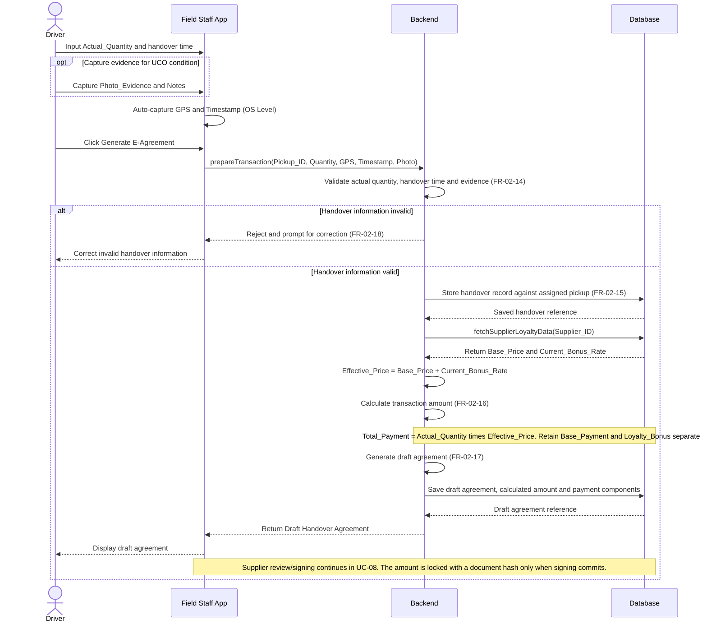

# Sequence Diagram: SD-UC-07 Input Handover Information

Lesson 4, analysis level. The driver submits the actual handover information and ReFeed prepares the draft agreement. Supplier review and signing continue in [SD-UC-08](SD-UC-08.md), matching the boundary of [AD-UC-07](../activity/AD-UC-07.md).

| Field | Value |
|---|---|
| Use case | UC-07 Input Handover Information |
| Version / status | v2 · Draft; signing separated into UC-08 on 2026-11-25 |
| Current W1 functions | FR-02-14–FR-02-18 |
| Legacy family | Original FR-02-03; see W1's legacy crosswalk |
| Lifelines | Driver; Field Staff App; Backend; Database, retained from the existing handover sequence |
| Verification | Rendered with mermaid-cli 11.16.0 / Mermaid 11.17.2 on 2026-11-25 |

The existing combined sequence previously included supplier signing, document locking and pickup completion after draft generation. Those interactions now belong to SD-UC-08. UC-07 retains handover validation/storage, the existing price and bonus calculation, and draft generation; it does not complete the pickup or credit the payout balance.

The system-validation `alt` corresponds to AD-UC-07 `d1`. Evidence requirements still follow AD-UC-07 and its existing open question; this edit does not define new photo/GPS limits.
