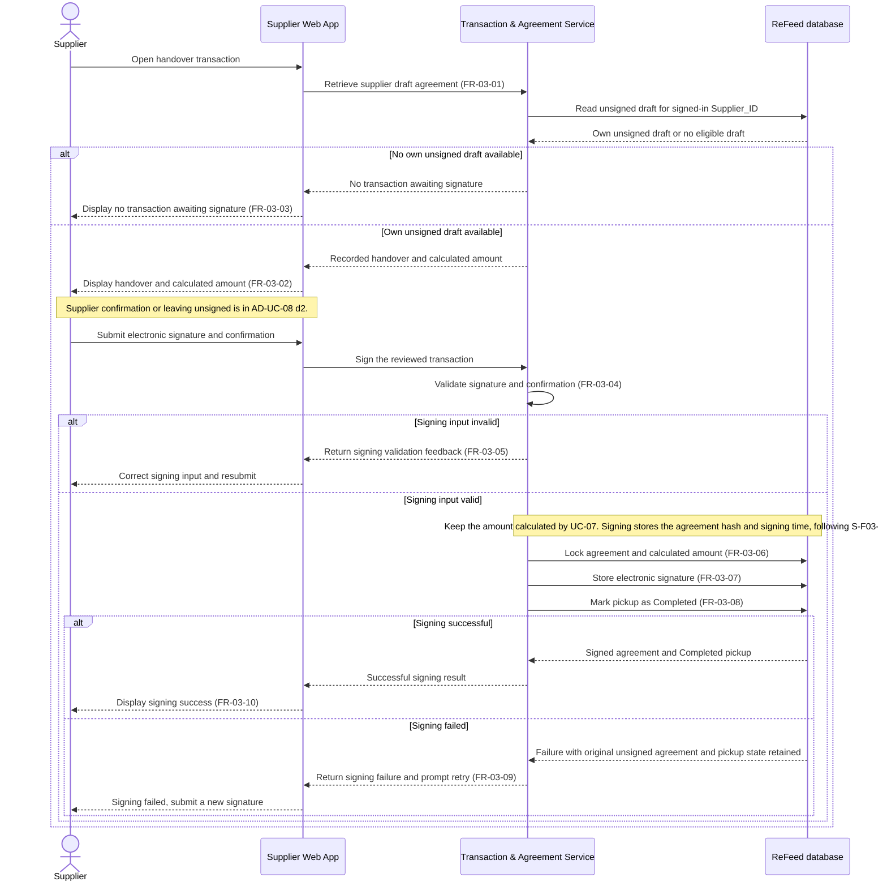

# Sequence Diagram: SD-UC-08 Confirm and sign a UCO transaction

Lesson 4, analysis level. Supplier review/confirmation choices are in [AD-UC-08](../activity/AD-UC-08.md). This sequence shows the interactions between the Supplier Web App, Transaction & Agreement Service and ReFeed database from the [physical design](../architecture/architecture.md).

| Field | Value |
|---|---|
| Use case | UC-08 Confirm and sign a UCO transaction |
| Primary actor | Supplier |
| Version / status | v1.1 · Draft |
| Inputs | [AD-UC-08](../activity/AD-UC-08.md) · [W1](../function-list/w1-function-list.md) FR-03-01–FR-03-10 · [SD-UC-07](SD-UC-07.md) · [S-F03-01](../external-design/screens/screen-spec-S-F03-01.md) |
| Preconditions | Supplier is signed in. UC-07 has prepared the draft agreement with its calculated amount. |
| Success end state | Reviewed agreement/amount locked, signature/signing time stored, pickup Completed. |
| Other results | No own unsigned draft, invalid signing input or a signing failure; the supplier may leave without submitting a signature. |

## Interaction trace

| AD action | Current W1 function | Interaction |
|---|---|---|
| s1 | FR-03-01 | Retrieve the supplier's own unsigned draft. |
| s2 | FR-03-02 | Display the recorded handover and calculated amount read-only. |
| s3 | FR-03-03 | Display that no transaction awaits signature. |
| s4 | FR-03-04 | Validate the signature and explicit confirmation. |
| s5 | FR-03-05 | Return correction feedback for invalid signing input. |
| s6 | FR-03-06 | Lock the agreement hash with the reviewed amount. |
| s7 | FR-03-07 | Store the signature and signing time against the transaction. |
| s8 | FR-03-08 | Mark the linked pickup Completed on successful signing. |
| s9 | FR-03-09 | Return the existing signing-failure/retry result. |
| s10 | FR-03-10 | Display signing success. |

The three system-outcome alternatives correspond to AD-UC-08 d1 (draft availability), d3 (input validity) and d4 (signing result). Supplier confirmation d2 remains an actor decision in the AD.

The agreement lock, signature storage and pickup completion form one signing operation: the failed result must leave the unsigned agreement and original pickup state unchanged, as required by S-F03-01 SR-007. Database transaction mechanics belong to implementation; the AD contains only the externally observable business result.

UC-07 supplies the handover and calculated amount. Receipt retrieval belongs to UC-09. The existing post-signing balance, verified-volume and tier updates remain in UC-12 / FR-05-03–FR-05-06; they are not additional UC-08 actions or new functions.
