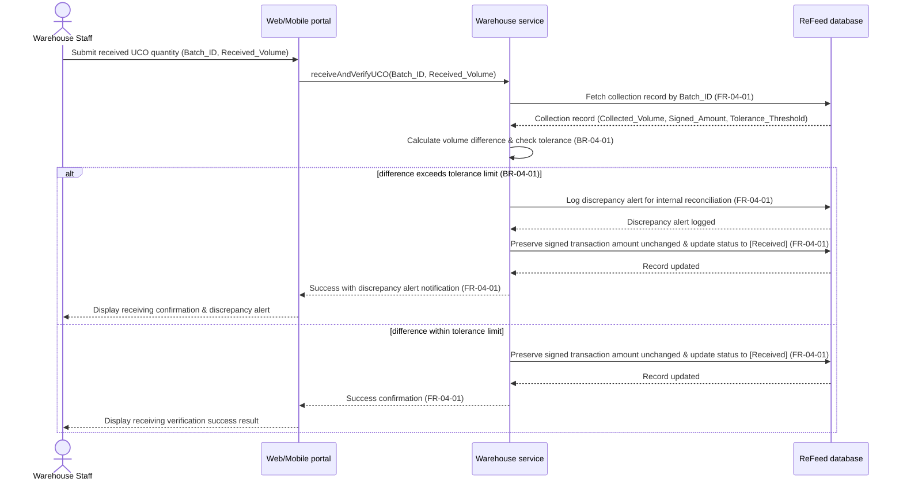

# Sequence Diagram: SD-UC-10 Receive and verify collected UCO at warehouse

Lesson 4, analysis level: how the parts of ReFeed talk to each other when warehouse staff record and verify received UCO quantity against collection records. The lifelines are the elements of the physical design. The warehouse staff's choice (to initiate receiving and enter quantities) is shown in the activity diagram AD-UC-10, not here.

| Field | Value |
|---|---|
| Use case | UC-10 Receive and verify collected UCO at warehouse |
| Feature | F-04 Warehouse & Traceability |
| Version | v1.0 (from AD-UC-10 v0.1) |
| FRs | FR-04-01 |
| Business Rules | BR-04-01 |

### Explanatory Notes

- **Preservation of Financial Integrity:** In both `alt` paths, the signed transaction amount remains unchanged regardless of volume differences to satisfy `FR-04-01` and financial audit requirements.
- **Discrepancy Triggering:** The `alt` fragment models internal business rules (`BR-04-01`) evaluated by the `Warehouse service` based on predefined tolerance thresholds.
- **Traceability:** State transition changes the collection record to `Received` upon completion.
