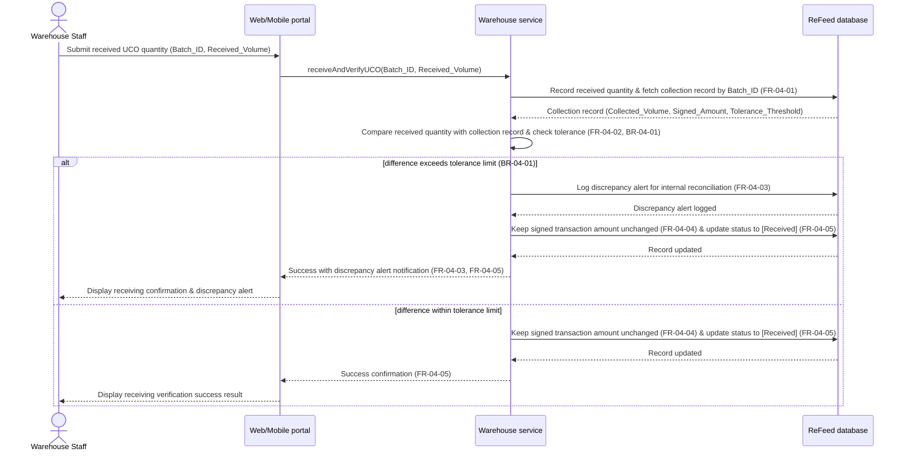

# Sequence Diagram: SD-UC-10 Receive and verify collected UCO at warehouse

Lesson 4, analysis level: how the parts of ReFeed talk to each other when warehouse staff record and verify received UCO quantity against collection records. The lifelines are the elements of the physical design. The warehouse staff's choice (to initiate receiving and enter quantities) is shown in the activity diagram AD-UC-10, not here.

| Field | Value |
|---|---|
| Use case | UC-10 Receive and verify collected UCO at warehouse |
| Feature | F-04 Warehouse & Traceability |
| Version | v1.0 (from AD-UC-10 v0.1) |
| FRs | FR-04-01, FR-04-02, FR-04-03, FR-04-04, FR-04-05 |
| Business Rules | BR-04-01 |

The alt fragments here are outcomes decided inside the system (tolerance evaluation per BR-04-01), so they belong in a sequence diagram. The actor's initial action of submitting received batch data is shown in the activity diagram instead.
