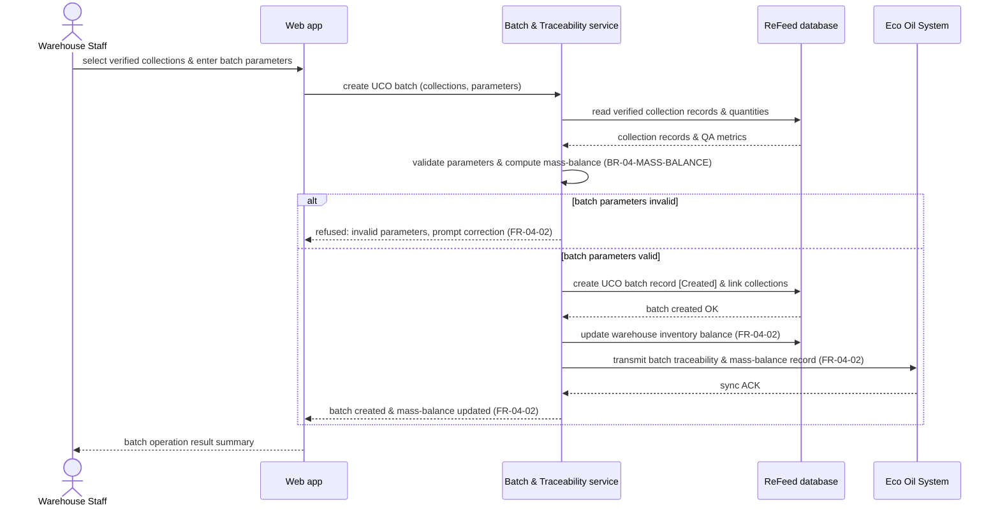

# Sequence Diagram: SD-UC-11 Manage UCO batch and mass-balance records

> Analysis level sequence diagram for ReFeed System. The Warehouse Staff aggregates verified collections into UCO batches, validates mass-balance metrics, updates inventory, and syncs batch records with Eco Oil System.

| Field | Value |
|---|---|
| Use case | UC-11 Manage UCO batch and mass-balance records |
| Version | v1 |
| FRs | FR-04-02, FR-04-03 |

