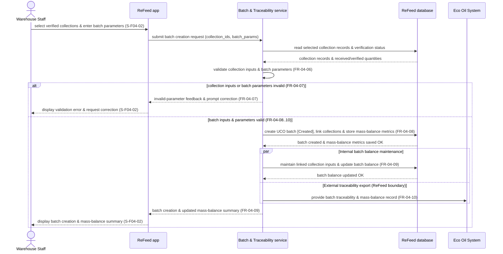

# Sequence Diagram: SD-UC-11 Manage UCO batch and mass-balance records

> Analysis-level sequence diagram for ReFeed System (aligned with W0/W1 revision `08e751f` and Screen List). Warehouse Staff aggregates verified UCO collections into a batch, validates parameters, computes mass-balance metrics, maintains internal batch balances, and provides traceability records to Eco Oil System in parallel.

| Field | Value |
|---|---|
| Use case | UC-11 Manage UCO batch and mass-balance records |
| Feature | F-04 Warehouse & Traceability |
| Primary actor | Warehouse Staff (`Warehouse Staff` for `FR-04-06`–`FR-04-10`; `ReFeed Staff` for deferred `FR-04-11`) |
| Version | v2 (aligned with `08e751f`) |

