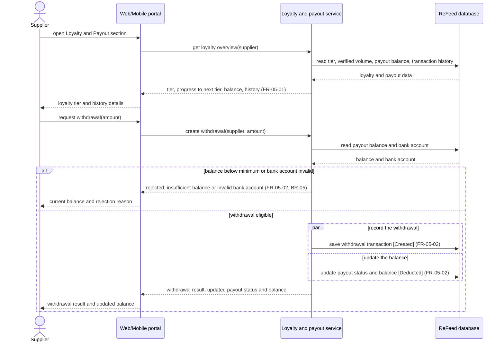

# Sequence Diagram: SD-UC-12 Manage loyalty status and accumulated payout balance

Lesson 4, analysis level: how the parts of ReFeed talk to each other when a supplier opens the
Loyalty & Payout section, views the loyalty tier and history, and requests a withdrawal. The
lifelines are the elements of the [physical design](../architecture/architecture.md). The supplier's
choice (view tier and history, or request a withdrawal) is shown in the activity diagram
[AD-UC-12](../activity/AD-UC-12.md), not here.

| Field | Value |
|---|---|
| Use case | UC-12 Manage loyalty status and accumulated payout balance |
| Version | v1 (from AD-UC-12 v1.0) |
| FRs | FR-05-01, FR-05-02 |

The `alt` fragment here is an outcome decided inside the system, so it belongs in a sequence
diagram. The `par` fragment is the fork and join of the activity diagram: the two saves run in
parallel and the result is shown after both finish. The supplier's choice between viewing and
withdrawing would be a decision in the activity diagram instead.

