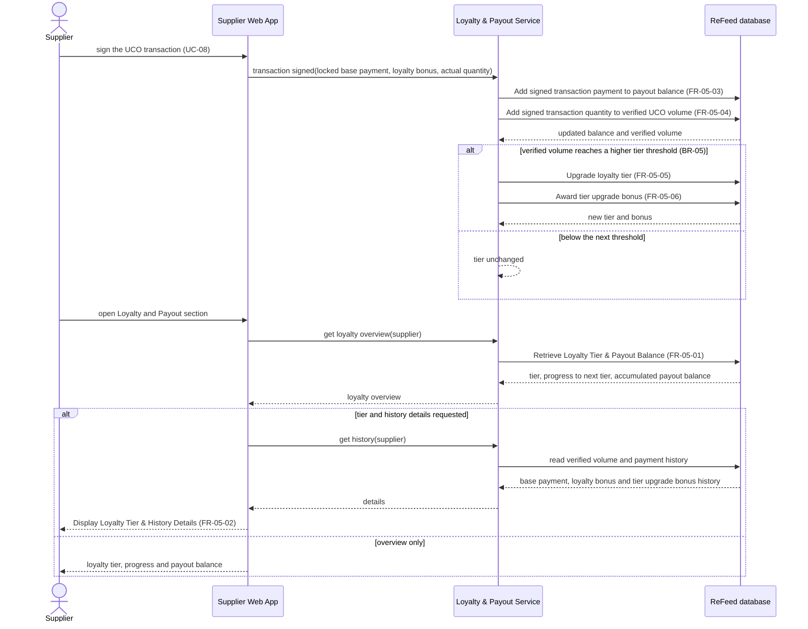

# Sequence Diagram: SD-UC-12 Manage loyalty status and accumulated payout balance

Lesson 4, analysis level: how the parts of ReFeed talk to each other when a signed UCO transaction
updates the supplier's payout balance, verified volume and loyalty tier, and when the supplier later opens
the Loyalty & Payout section. The lifelines are the elements of the
[physical design](../architecture/architecture.md). The supplier's actions are shown in the activity
diagram [AD-UC-12](../activity/AD-UC-12.md).

| Field | Value |
|---|---|
| Use case | UC-12 Manage loyalty status and accumulated payout balance |
| Primary actor | Supplier |
| Version / status | v2.0 · Rebuilt on the current W1 |
| Inputs | [AD-UC-12](../activity/AD-UC-12.md) · [W1](../function-list/w1-function-list.md) FR-05-01 to FR-05-06 · [SD-UC-08](SD-UC-08.md) |
| FRs | FR-05-01, FR-05-02, FR-05-03, FR-05-04, FR-05-05, FR-05-06 (each appears once) |
| Preconditions | The supplier is signed in and the account is `Active`. A UCO transaction has been signed in UC-08. |
| Success end state | Payment and quantity are added, the tier is upgraded with a bonus when a higher threshold is reached, and the supplier sees the loyalty status and payout balance. |
| Other results | No tier upgrade when the verified volume stays below the next threshold. There is no withdrawal and no bank API. |

The `alt` fragments are outcomes decided inside the system or by what the supplier asks for, as in the
activity diagram. Updating the balance, volume and tier happens automatically after UC-08. There is no
withdrawal in this sequence because ReFeed has no bank API. Each FR is written on one message only, with
its exact W1 name, in the same place as the matching action in AD-UC-12.
