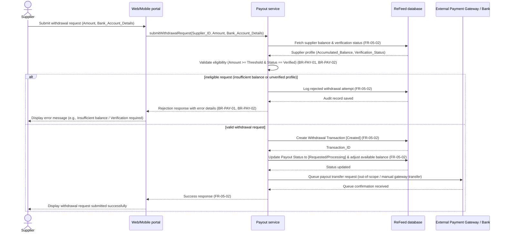

# Sequence Diagram: SD-UC-13 Withdraw accumulated payout balance

Lesson 4, analysis level: how the parts of ReFeed talk to each other when a supplier submits a withdrawal request for their accumulated payout balance. The lifelines are the elements of the physical design. The supplier's choice (to request a withdrawal) is shown in the activity diagram AD-UC-13, not here.

| Field | Value |
|---|---|
| Use case | UC-13 Withdraw accumulated payout balance |
| Feature | F-05 Supplier Value & ESG / Green Profile |
| Version | v1.0 (from AD-UC-13 v0.1) |
| FRs | FR-05-02 |
| Business Rules | BR-PAY-01, BR-PAY-02 |

The alt fragments here are outcomes decided inside the system (eligibility evaluation per BR-PAY-01 and BR-PAY-02), so they belong in a sequence diagram. The supplier's choice to submit a withdrawal request is shown in the activity diagram instead.
