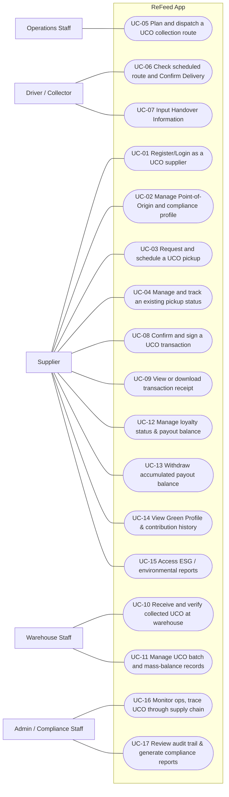

# Use Case Diagram: ReFeed App

> Worked example based on the ReFeed App system scope ([ReFeed] Group D_K63DB_DBIZ II.xlsx). 

Use case diagram for the ReFeed App, mapping primary actors to their respective system functionalities. Mermaid has no use case diagram type, so the diagram below is drawn as a flowchart: people on the outside, use cases (rounded) inside the system boundary.

| Field | Value |
|---|---|
| Version | v2 |
| Actors | Supplier, Operations Staff, Driver / Collector, Warehouse Staff, Admin / Compliance Staff (primary) |

## Diagram

The full use case inventory, with features and login rules, is documented in W0 Table 1 of the system scope file (`W0_Scope`).

## Sequence diagrams

One sequence diagram per use case, at analysis level: the lifelines are the elements of the physical design. Based on `W1_FunctionList` source traces:

| Use case | Sequence diagram | Status |
|---|---|---|
| UC-04, UC-05, UC-06, UC-07, UC-10, UC-11 | [SD-S-01](SD-S-01.md) | Done (Pickup, Route & Handover flows) |
| UC-08, UC-09, UC-11 | [SD-S-02](SD-S-02.md) | Done (Transaction & Traceability flows) |
| UC-15, UC-17 | [SD-S-03](SD-S-03.md) | Done (ESG & Audit Report flows) |
| Other UC (01, 02, 03, 12, 13, 14, 16) | (not drawn in this example) | Students practise on these |

## Change log

| Version | When | Change | Why |
|---|---|---|---|
| v1 | Mid-term | Nineteen use cases, actors UCO Supplier, UCO Collector, Admin, Warehouse | Extracted from Group D - Mid-term Presentation |
| v2 | Current | Refined to 17 use cases across 5 explicit actor roles | Aligned with W0_Scope and W1_FunctionList in `[ReFeed] Group D_K63DB_DBIZ II.xlsx` |
