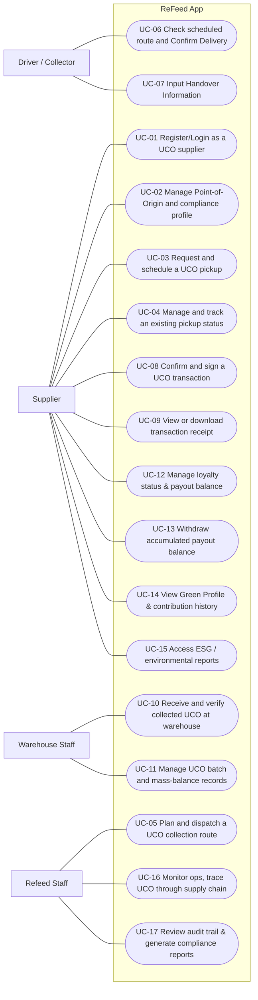

# Use Case Diagram: ReFeed App

| Field | Value |
|---|---|
| Version | v2 |
| Actors | Supplier, Driver / Collector, Warehouse Staff, Refeed Staff |

## Diagram

The full use case inventory, with features and login rules, is documented in W0 Table 1 of the system scope file (`W0_Scope`).

## Sequence diagrams

One sequence diagram per use case, at analysis level: the lifelines are the elements of the physical design. Based on `W1_FunctionList` source traces:

| Use case | Sequence diagram | Status |
|---|---|---|
| UC-01 Register or log in as a UCO supplier | [SD-UC-01](SD-UC-01.md) | Done |
| UC-02 Manage point-of-origin and compliance profile | SD-UC-02 | Not drawn |
| UC-03 Request and schedule a UCO pickup | [SD-UC-03](SD-UC-03.md) | Done |
| UC-04 Track and manage a pickup status | [SD-UC-04](SD-UC-04.md) | Done |
| UC-05 Plan and dispatch a collection route | [SD-UC-05](SD-UC-05.md) | Done |
| UC-06 Check route and confirm delivery | [SD-UC-06](SD-UC-06.md) | Done |
| UC-07 Input handover information | [SD-UC-07](SD-UC-07.md) | Done |
| UC-08 Confirm and sign a UCO transaction | SD-UC-08 | Not drawn |
| UC-09 View or download a transaction receipt | SD-UC-09 | Not drawn |
| UC-10 Receive and verify collected UCO at warehouse | [SD-UC-10](SD-UC-10.md) | Done |
| UC-11 Manage UCO batch and mass-balance records | [SD-UC-11](SD-UC-11.md) | Done |
| UC-12 Manage loyalty status and payout balance | [SD-UC-12](SD-UC-12.md) | Done |
| UC-13 Withdraw accumulated payout balance | [SD-UC-13](SD-UC-13.md) | Done |
| UC-14 to UC-17 | SD-UC-14 to SD-UC-17 | Not drawn |

## Change log

| Version | When | Change | Why |
|---|---|---|---|
| v1 | Mid-term | Nineteen use cases, actors UCO Supplier, UCO Collector, Admin, Warehouse | Extracted from Group D - Mid-term Presentation |
| v2 | Current | Refined to 17 use cases across 5 explicit actor roles | Aligned with W0_Scope and W1_FunctionList in `[ReFeed] Group D_K63DB_DBIZ II.xlsx` |
