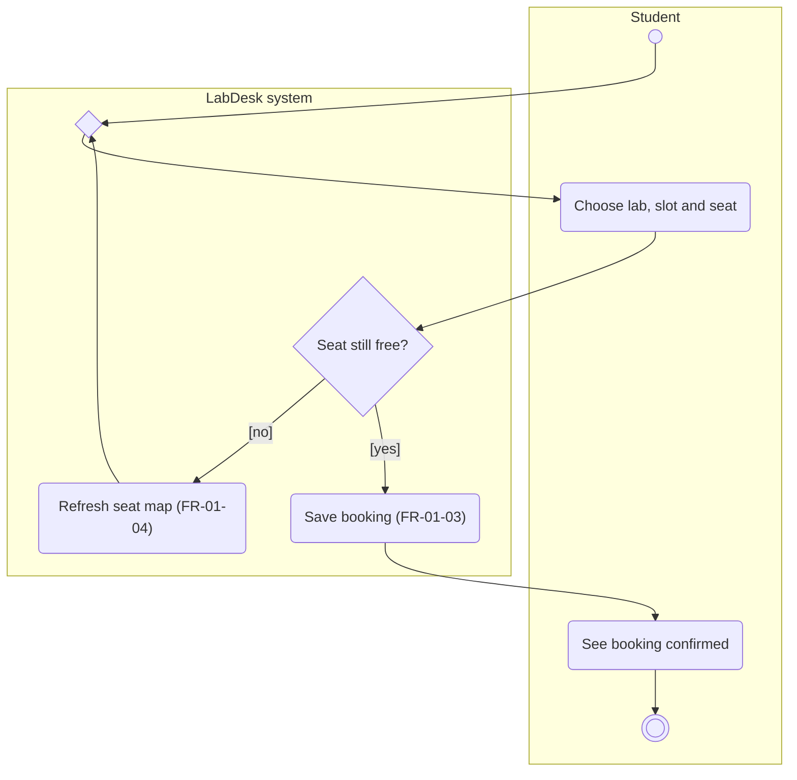

# DBIZ2 activity profile: UML activity diagrams as Mermaid

DBIZ2, Lesson 7. Keep this file open in the workshop.

This file fixes **one way** to write UML activity diagrams as text in this course, so that every
team's diagrams look alike, render the same everywhere (mermaid.live now, GitHub in DBIZ3), and can be
read by an AI coding agent in DBIZ3.

- Notation source: OMG Unified Modeling Language 2.5.1, Clause 15 Activities (OMG document
  formal/2017-12-05, December 2017).
- Syntax source: Mermaid documentation, Flowchart (expanded node shapes, v11.3.0+) and Swimlanes
  (`swimlane-beta`, v11.16.0+), mermaid.js.org, accessed October 2026.

---

## 1. The ten symbols of the course profile

UML defines many more elements. This course uses ten. If you need something that is not here,
write it as a note under the diagram and ask the lecturer before inventing a symbol.

| # | UML element | Meaning | Mermaid syntax |
|---|---|---|---|
| 1 | Initial node | where the activity starts | `start@{ shape: sm-circ }` |
| 2 | Action | one step of work, verb + object | `a1("Save booking (FR-01-03)")` |
| 3 | Control flow | order of steps | `a1 --> a2` |
| 4 | Decision | choose one outgoing flow | `d1{"Seat still free?"}` with labelled flows `-->|"[yes]"|` |
| 5 | Merge | bring alternative flows back together | `m1{" "}` (an empty diamond) |
| 6 | Fork | split into flows with no required order | `f1@{ shape: fork }` |
| 7 | Join | wait until all flows from the fork arrive | `j1@{ shape: join }` |
| 8 | Activity final | the whole activity stops | `stop1@{ shape: fr-circ }` |
| 9 | Object node with state | a thing produced or changed, in a named state | `o1["Booking [Confirmed]"]` |
| 10 | Time event | the activity starts or waits because of time | `t1@{ shape: hourglass }` and put the time expression on its outgoing arrow |

Plus **swimlanes** (UML: activity partitions): one `subgraph` per lane inside `swimlane-beta`.

Note on flow final (UML: a circle with an X, "this branch stops, the others go on"): Mermaid has a
crossed-circle shape, `x1@{ shape: cross-circ }`. Use it only when a branch stops while other
concurrent branches continue. Most student diagrams never need it.

## 2. Writing rules

1. **Actions are verb + object**, from the point of view of the lane that does them:
   "Save booking", not "Booking" or "The system will save the booking".
2. **Every action in the system lane cites the FR it implements**, in brackets at the end.
3. **Every outgoing flow of a decision has a guard** in square brackets: `[yes]`, `[no]`,
   `[seat taken]`, `[else]`. Guards of one decision never overlap and together cover every case.
4. **Never send two flows straight into an action.** Put a merge in front. In UML an action with
   two incoming control flows waits for a token on both (UML 2.5.1, sub clause 15.2.3.2), which is
   a join, not an "either".
5. **Every fork has a join** before the activity ends, unless a branch ends in a flow final.
6. **Lane names are copied** from the actors of the use case and the external entities of the
   Context Diagram. Do not invent job titles.
7. **Object states use the exact names** that will become status values in the data model.
8. **One diagram per use case.** A diagram over roughly 25 nodes is two use cases or one use case
   with too much screen detail.
9. **No screen detail.** "Choose a seat" is an action. "Click the blue button at the top right" is
   not.

## 3. Pattern A: swimlane activity (course default)

Needs Mermaid 11.16 or later. Use it for every use case with more than one lane.

```mermaid
swimlane-beta TB
  subgraph STU["Student"]
    start@{ shape: sm-circ }
    a1("Choose lab, slot and seat")
    a3("Choose another seat")
    a2("See booking confirmed")
    stop1@{ shape: fr-circ }
  end
  subgraph SYS["LabDesk system"]
    m1{" "}
    d1{"Seat still free?"}
    s1("Refresh seat map (FR-01-04)")
    s2("Save booking (FR-01-03)")
    o1["Booking [Confirmed]"]
    f1@{ shape: fork }
    s3("Update free-seat count")
    j1@{ shape: join }
  end
  subgraph MAIL["Email service"]
    e1("Send confirmation email (FR-01-06)")
  end
  start --> a1 --> m1 --> d1
  d1 -->|"[no]"| s1 --> a3 --> m1
  d1 -->|"[yes]"| s2 --> o1 --> f1
  f1 --> s3 --> j1
  f1 --> e1 --> j1
  j1 --> a2 --> stop1
```

## 4. Pattern B: single-lane system activity started by time

```mermaid
swimlane-beta TB
  subgraph SYS["LabDesk system"]
    t1@{ shape: hourglass }
    s1("Find bookings still Confirmed (FR-02-04)")
    d1{"Any found?"}
    s2("Set each to No-show and free the seat (FR-02-04)")
    stop1@{ shape: fr-circ }
  end
  t1 -->|"15 min after slot start"| s1 --> d1
  d1 -->|"[yes]"| s2 --> stop1
  d1 -->|"[no]"| stop1
```

Note: two flows enter `stop1` here. That is allowed: a final node is not an action, and the first
token that reaches it ends the activity.

## 5. Pattern C: fallback when `swimlane-beta` does not render

`swimlane-beta` is new and marked beta in the Mermaid documentation; its syntax may still change.
If your renderer is older than Mermaid 11.16 (for example an old editor plugin), use a normal
flowchart with one subgraph per lane. The content and the IDs stay the same; only the first line
and the lane layout change.



## 6. Check that it renders, every time

1. Paste the block into the Mermaid Live Editor (mermaid.live). No account is needed.
2. If you see "Syntax error", the most common causes are: a label without double quotes that
   contains `( ) [ ] { }`, an unescaped `"` inside a quoted label, a node named `end`, a missing
   `end` after a `subgraph`, or a renderer older than 11.16 for `swimlane-beta`.
3. A node ID reused for two different nodes gives no error: the two boxes become one and the later
   label wins. Count the nodes against your sketch.
4. A diagram that does not render is not submitted. In DBIZ3, diagrams are checked by machine
   with mermaid-cli before any human reads them.

In DBIZ3 (from Session 6) these files move into a GitHub repository. GitHub renders Mermaid blocks
in Markdown files natively (GitHub Blog, 14 Feb 2022). A public check dated 6 October 2026 reported
GitHub's viewer on Mermaid 11.17.2, which includes `swimlane-beta`; check again when you move.

---

Sources

- OMG. *Unified Modeling Language, Version 2.5.1*. Document formal/2017-12-05, December 2017.
  https://www.omg.org/spec/UML/2.5.1/
- Mermaid documentation, "Flowcharts Syntax" (expanded node shapes, v11.3.0+) and
  "Swimlanes Diagram Syntax" (v11.16.0+). https://mermaid.js.org/ (accessed October 2026).
- Woodward, M. and Biagianti, A. "Include diagrams in your Markdown files with Mermaid".
  The GitHub Blog, 14 February 2022.
- Public render check of GitHub's Mermaid version, issue #254 in JeanKadang/DOC-GitHub-Practice-Skills,
  6 October 2026 (third-party report, not an official GitHub statement).
